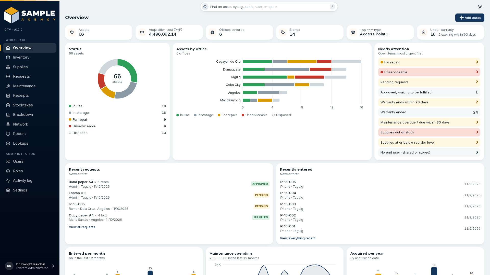
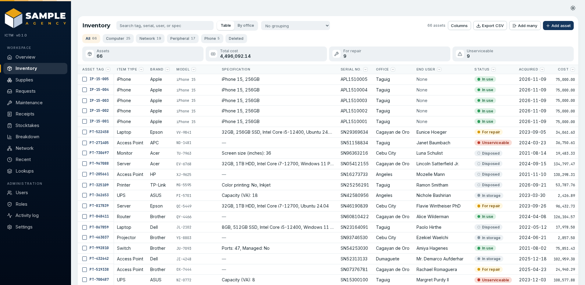
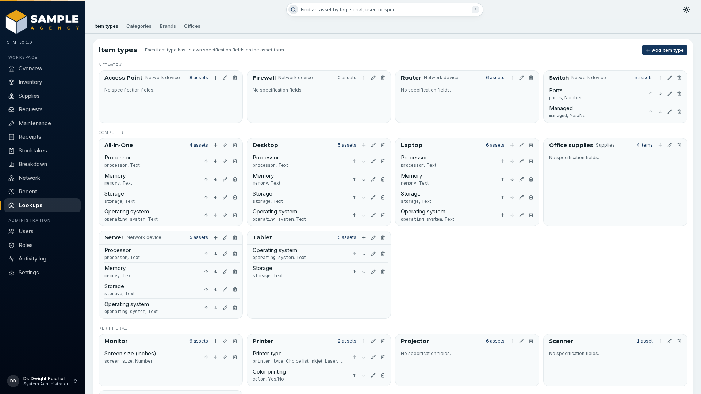
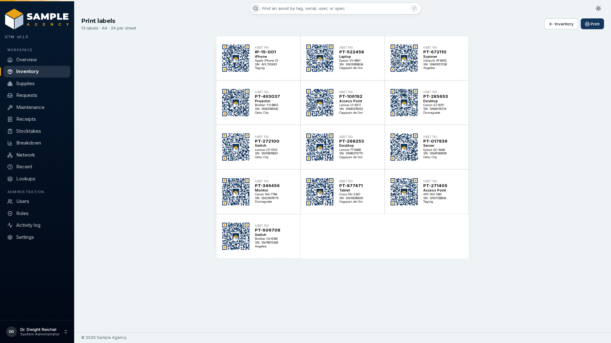
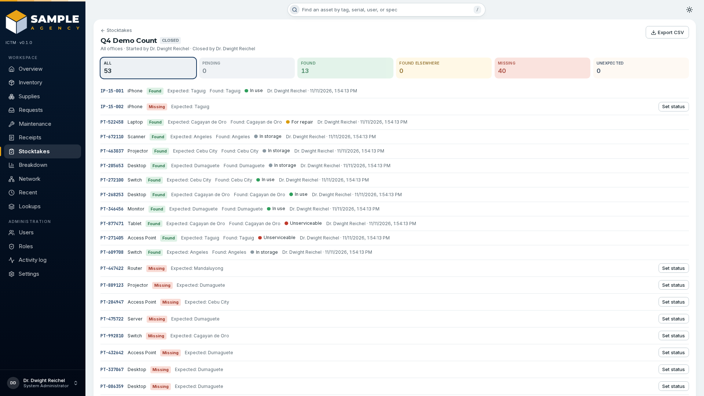
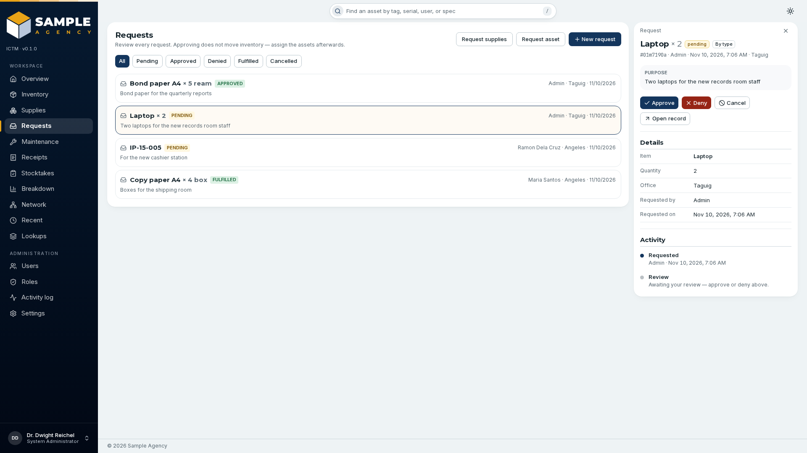
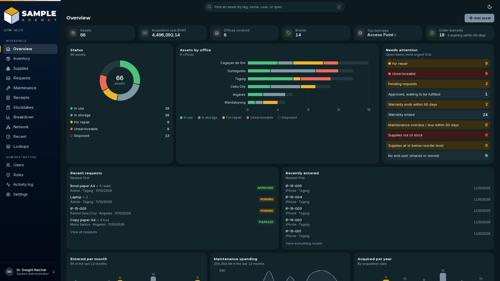
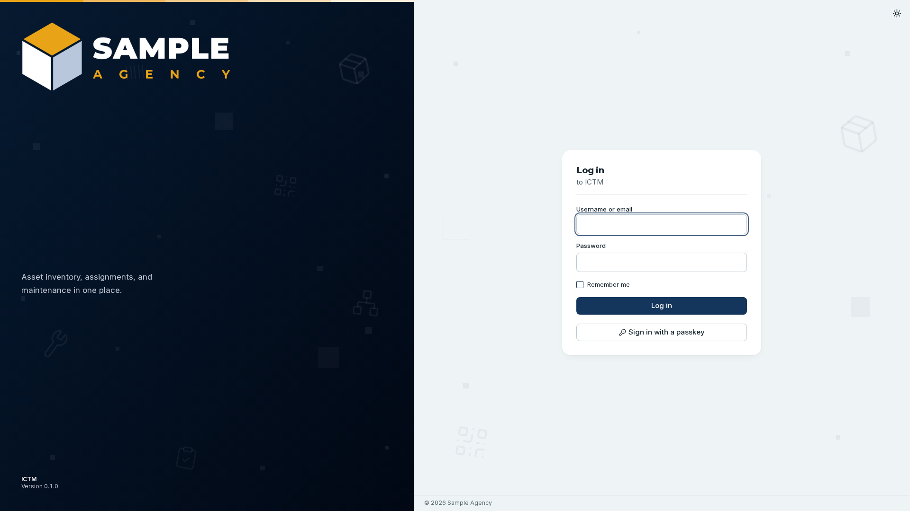
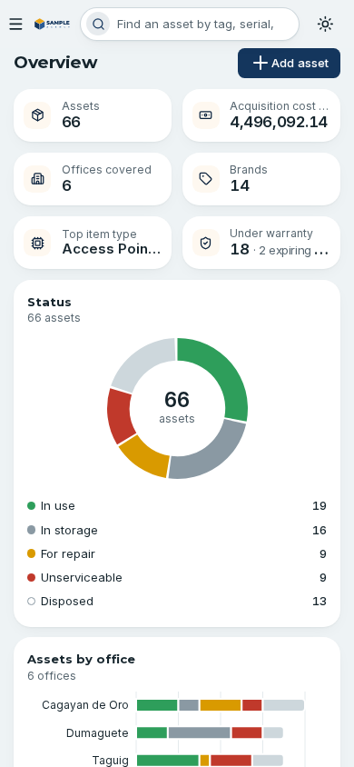

# Asset Management System

A web app for tracking an organization's equipment: what it owns, who holds each item, what condition it is in, and the paperwork around it.

> The source code is private. This repository holds an overview and screenshots. All data shown is sample data under a placeholder organization.

## Features

- **Inventory:** each item type defines its own specification fields. Search by tag, serial number, user, or specification; add assets one at a time or in bulk; attach files; export to CSV.
- **Assignments and receipts:** reassignment between offices and users with a history per asset, and printable receipts with multiple signatories.
- **QR labels:** printable label sheets. Scanning a label opens the asset, where it can be counted into an open stocktake.
- **Stocktakes:** assets marked as found, found elsewhere, missing, or unexpected, with CSV export.
- **Supplies:** consumable stock with a movement ledger, reorder levels, and issue slips.
- **Requests:** staff request assets or supplies; reviewers approve, deny, and fulfill them.
- **Maintenance:** repair and service records, and preventive maintenance schedules.
- **Network:** network devices with IP addresses, arranged by what each one connects through.
- **Administration:** users, roles and permissions, user impersonation for support, and an activity log.
- **White-labeling:** name, logos, colors, heading font, terminology, and receipt details are settings.
- **Interface:** light and dark themes, usable on phones.

## Security

- Two-factor authentication is required: an authenticator app or a passkey.
- Cookie-based SPA authentication, with permissions enforced by the API on protected actions.
- Login throttling and lockout, with sign-ins recorded in the activity log.
- Nonce-based Content Security Policy.

## Built with

| Layer | Technologies |
| --- | --- |
| Frontend | Next.js 16, React 19, TypeScript, Tailwind CSS 4, shadcn/ui, TanStack Query and Table, Recharts |
| Backend | Laravel 13, Sanctum, Passkeys, spatie/laravel-permission, spatie/laravel-activitylog |
| Data | PostgreSQL, Redis |
| Testing and tooling | Pest, Playwright, Biome, pnpm |

## Screenshots

### Inventory

### Item types and specification fields

### QR labels

### Stocktake

### Requests

### Dark theme

### Login

### On a phone

